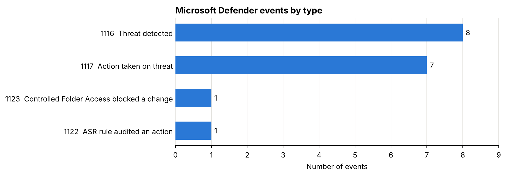

# Windows Defender Lab

A hands on lab where I patch, harden and monitor a Windows 11 machine with Microsoft Defender, trigger safe test alerts, investigate them through the event logs and automate a health report in PowerShell.

I built this to learn how endpoint protection is run day to day in a security team, and to practise the patching, hardening and alert triage work that entry level analyst roles involve.

## Status

| Stage | Status |
|---|---|
| Lab setup | Done |
| Baseline and patching | Done |
| Hardening | Done |
| Safe detection tests | Done |
| Alert investigation and triage notes | Done |
| First line analyst playbook | Done |
| Automated health report (PowerShell) | Done |
| Chart of events (Python) | Done |
| Advanced hunting with KQL | Planned |

## Results at a Glance

| Measure | Result |
|---|---|
| Protections hardened | PUA protection, Controlled Folder Access, 4 attack surface reduction rules |
| Safe detection tests run | 4, all detected |
| Alerts triaged | 5 (4 test detections, 1 false positive from normal Windows activity) |
| Defender events reviewed | 17 (8 detections, 7 actions, 1 ASR audit, 1 Controlled Folder Access block) |
| Fastest automatic response | 5 seconds from detection to removal (EICAR) |
| Manual remediation | 1 PUA detection that Defender did not remove, cleared in 11 minutes |
| Active threats at the end | 0 |

## Repository Contents

| Path | Content |
|---|---|
| `README.md` | This write up |
| `triage_notes.md` | A triage note for each of the five alerts |
| `playbook.md` | One page playbook for a first line analyst |
| `scripts/Defender-HealthReport.ps1` | PowerShell script that produces the health report |
| `scripts/chart_events.py` | Python script that charts the events CSV |
| `sample-report/` | A real report from the lab, with user and computer names hidden |
| `screenshots/` | Evidence for each step |

## Lab Setup

| Item | Detail |
|---|---|
| Host | MacBook Air, Apple silicon |
| Virtualisation | UTM |
| Guest | Windows 11 Pro, Arm64, 8 GB RAM, 64 GB disk |
| Account | Local account, no Microsoft account |
| Rollback | A clean clone of the VM taken before any change |

Everything runs inside the virtual machine, so the host is never exposed to test files and the lab can be reset at any time.

## Baseline and Patching

I recorded the state of the machine with `Get-MpComputerStatus` before changing anything, then patched it and recorded it again.

| Item | Before | After |
|---|---|---|
| Real time protection | On | On |
| Behaviour monitoring | On | On |
| Tamper Protection | On | On |
| Signature version | 1.463.315.0 | 1.463.317.0 |
| Signature age | 0 days | 0 days |
| Quick scan | Never run | Completed, age 0 days |
| Windows quality updates | Pending | 3 installed (2 security, 1 critical) |
| Driver updates | Pending | 1 installed |

**Main finding.** Protection was on and signatures were current, but the machine had never been scanned. `QuickScanAge` showed 4294967295, the largest value the field can hold, which Defender uses to mean no scan on record. After `Start-MpScan -ScanType QuickScan` it dropped to 0.

## Hardening

Several Defender protections are off or only partly on by default. I checked each one with `Get-MpPreference`, changed it with `Set-MpPreference`, then checked again.

| Protection | Before | After |
|---|---|---|
| Potentially unwanted app (PUA) protection | Audit only | Block |
| Controlled Folder Access (ransomware protection) | Off | On |
| Cloud delivered protection | On | On |
| Automatic sample submission | On | On |
| Tamper Protection | On | On |
| Attack surface reduction rules | None | 4 rules in block mode |

### Attack Surface Reduction Rules

Rule IDs are taken from Microsoft's attack surface reduction rules reference.

| Rule | GUID | Mode |
|---|---|---|
| Block credential stealing from LSASS | 9e6c4e1f-7d60-472f-ba1a-a39ef669e4b2 | Block |
| Use advanced protection against ransomware | c1db55ab-c21a-4637-bb3f-a12568109d35 | Block |
| Block execution of potentially obfuscated scripts | 5beb7efe-fd9a-4556-801d-275e5ffc04cc | Block |
| Block process creations from PSExec and WMI commands | d1e49aac-8f56-4280-b9ba-993a6d77406c | Block |

I added the rules in audit mode first. Audit mode logs what a rule would have blocked (event 1122) without stopping it, so false positives can be found before the rule is enforced. One audit event was logged, where the Windows SysMain service accessed lsass.exe. I reviewed it, judged it a false positive and moved the rules to block mode. None of the rules has blocked anything since (no event 1121).

## Safe Detection Tests

Four harmless test files and commands that security teams use to check their defences. No real malware was used.

| Test | Method | Result |
|---|---|---|
| EICAR test file | Downloaded the zip from eicar.org in Edge | Blocked during download and removed in 5 seconds |
| AMSI test string | Ran Microsoft's AMSI test sample in PowerShell | Script blocked before it ran, no file involved |
| Controlled Folder Access | PowerShell tried to write a file into Documents | Write blocked, no file created |
| PUA test file | Downloaded the AMTSO Android PUA test file | Detected, then removed by me through Protection history |

## Investigation

Each alert was investigated with `Get-MpThreatDetection`, `Get-MpThreat` and the Microsoft-Windows-Windows Defender/Operational event log, then written up in [triage_notes.md](triage_notes.md) with the file, process, action taken, severity, MITRE ATT&CK technique and verdict.

| Alert | Event IDs | MITRE ATT&CK | Verdict |
|---|---|---|---|
| LSASS access by svchost.exe (SysMain) | 1122 | T1003.001 | False positive |
| EICAR test file | 1116, 1117 | T1204.002 | True positive (test) |
| AMSI test string | 1116, 1117 | T1059.001 | True positive (test) |
| Controlled Folder Access block | 1123 | T1486 | True positive (test) |
| PUA test file | 1116, 1117 | T1204.002 | True positive (test) |

The steps I followed are written up as a reusable guide in [playbook.md](playbook.md).

## Automated Health Report

[Defender-HealthReport.ps1](scripts/Defender-HealthReport.ps1) repeats the manual checks in one run. It collects `Get-MpComputerStatus`, `Get-MpPreference`, `Get-MpThreat`, `Get-MpThreatDetection` and the five Defender event types with `Get-WinEvent`, then writes:

* a text summary with an overall verdict of HEALTHY or ATTENTION NEEDED
* a CSV of detections with threat names
* a CSV of events in time order

The script hides the user name and computer name by default, so reports can be shared safely. A real run from the lab is in [sample-report](sample-report).

**Changes I made after testing.** The first run printed the last scan date in month first format while the rest of the report was day first. I changed that line to format the date as day, month, year, and to print "Never" when no scan exists, which is the state I found in the baseline.

[chart_events.py](scripts/chart_events.py) reads the events CSV and draws the count of each event type.

## Problems and What I Learnt

* **Signature update failed on the first try.** `Update-MpSignature` returned "The remote procedure call failed" (0x800706be). Windows was updating the Defender engine in the background at the time. After Windows Update finished, the same command worked.
* **Check more than one source.** The Windows Update page showed one update waiting, while `Get-HotFix` listed five. The Update history page settled it, since Windows had installed most updates in the background before I looked.
* **Confirm the clock before trusting timestamps.** Some updates were dated a day ahead, so I checked the time zone and system time. Both were correct. I could not explain the date difference, so I rely on the Update history page for install dates.
* **A strange number can be a placeholder.** 4294967295 was not a real scan age. It meant never scanned.
* **Detected does not mean removed.** The PUA file was detected but stayed on disk as an active threat until I removed it. Every alert needs its status checked.
* **Protection works in layers.** Edge blocked the EICAR download while Defender raised the alert underneath. For the PUA file, Edge allowed the download and Defender caught it on disk.
* **Error messages can hide the cause.** When Controlled Folder Access blocked PowerShell, the error only said "Could not find file". The real reason was in the Defender log.
* **Hardening changes how you work.** The report script writes to `C:\DefenderLab` because Controlled Folder Access would block it from writing to Documents.

## Evidence

Screenshots are in the `screenshots` folder.

| File | Shows |
|---|---|
| 01_clean_snapshot.png | Clean clone of the VM before changes |
| 02_baseline_before.png | Defender status before patching |
| 03_signature_update_error.png | Signature update error |
| 04_updates_pending.png | Windows Update installing the pending update |
| 05_updates_done.png | Windows Update up to date |
| 05b_update_history.png | Update history |
| 06_patched_and_scanned.png | Updates, signature version and first scan |
| 07_hardening_before.png | Defender settings before hardening |
| 08_pua_cfa_enabled.png | PUA protection and Controlled Folder Access on |
| 09_asr_audit.png | Four ASR rules in audit mode |
| 10_windows_security_settings.png | Cloud protection and Tamper Protection on |
| 11_asr_enabled.png | Four ASR rules moved to block mode |
| 12_asr_audit_event.png | The LSASS audit event in full |
| 13_eicar_blocked.png | EICAR download blocked |
| 14_amsi_blocked.png | AMSI test string blocked in PowerShell |
| 15_cfa_blocked.png | Controlled Folder Access blocking a write |
| 16_pua_detected.png | PUA test file detected |
| 17_threat_list.png | Threats and detections listed in PowerShell |
| 18_protection_history_pua.png | PUA alert still active in Protection history |
| 19_pua_remediated.png | PUA removed and confirmed |
| 20_event_viewer.png | Defender Operational log in Event Viewer |
| 21_event_timeline.png | Event counts and timeline from PowerShell |
| 22_health_report.png | First run of the health report script |
| 23_health_report_fixed.png | Report after the date format fix |

## Tools

Microsoft Defender Antivirus, PowerShell, Windows Event Viewer, Windows Update, Python (matplotlib), UTM
